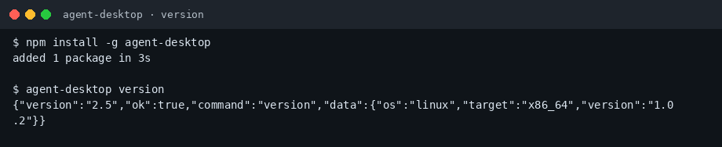
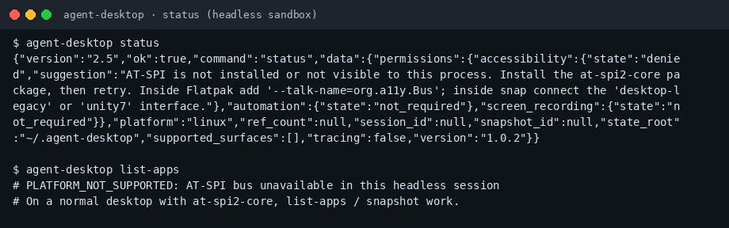
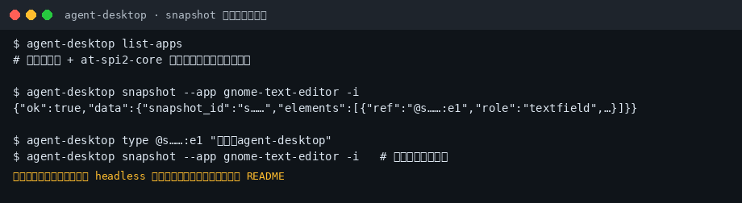

# agent-desktop 小白中文教程

> 给 AI Agent 用的桌面 Computer Use：通过操作系统**无障碍树**观察并操作 GUI，而不是猜像素（社区非官方教程）  
> 上游：[`vercel-labs/agent-desktop`](https://github.com/vercel-labs/agent-desktop) · 文档：[agent-browser.dev/desktop](https://agent-browser.dev/desktop)  
> 教程校对：2026-11-02（Asia/Shanghai）· 本机实测 **agent-desktop 1.0.2**（linux_x86_64，无障碍总线在 headless 沙盒不可用）

[](https://github.com/xianyu110/awesome-agent-desktop-zh)
[](https://github.com/vercel-labs/agent-desktop)
[](https://github.com/vercel-labs/agent-desktop/blob/main/LICENSE)
[](https://xianyu110.github.io/awesome-agent-desktop-zh/)

---

## 截图索引

| # | 文件 | 类型 | 说明 |
|---|------|------|------|
| 1 | [`images/01-version.png`](images/01-version.png) | **真实** | `npm install -g agent-desktop` 后 `agent-desktop version` → 1.0.2 |
| 2 | [`images/02-status.png`](images/02-status.png) | **真实** | `agent-desktop status`：headless 下 AT-SPI 不可用的诚实报错 |
| 3 | [`images/03-snapshot-loop-schematic.png`](images/03-snapshot-loop-schematic.png) | **示意图** | snapshot → 按 ref 操作 → 再 snapshot（摘自官方 README） |

---

## 这是什么？

**agent-desktop**（Rust CLI + C ABI）让 Agent 读取 macOS / Windows / Linux 上应用的无障碍树，拿到稳定 `@ref`，再执行点击、输入等操作，并用下一次 snapshot 验证——避免纯截图 CV 的脆弱匹配。

本仓库只提供**中文小白教程**（MIT）。上游许可证为 **Apache-2.0**。

---

## 官方链接（请以官方为准）

| 资源 | 链接 |
|------|------|
| 源码 | https://github.com/vercel-labs/agent-desktop |
| 文档站 | https://agent-browser.dev/desktop |
| 安装说明 | https://github.com/vercel-labs/agent-desktop/blob/main/docs/install.md |
| npm | https://www.npmjs.com/package/agent-desktop |

---

## 环境要求（摘要）

- **Node.js**（用 npm / pnpm / yarn / bun 全局安装）或直接下载 [Releases](https://github.com/vercel-labs/agent-desktop/releases) 原生包
- **macOS**：辅助功能权限（`agent-desktop permissions --guide`）
- **Windows**：同完整性级别下一般无需额外授权；SmartScreen 可能对浏览器下载的未签名包报警（npm 路径通常可避开）
- **Linux**：用户图形会话 + `at-spi2-core`；官方主测 Ubuntu 24.04+ / GNOME；TTY/SSH 无会话总线时看不到应用（本沙盒即此情况）

---

## 安装（macOS / Windows / Linux）

```bash
npm install -g agent-desktop
agent-desktop version
```

若包管理器默认拦截 install scripts（如部分 npm 12），按官方文档 `npm install-scripts approve agent-desktop` 或使用 `--allow-scripts`。



验证环境：

```bash
agent-desktop status
agent-desktop permissions   # macOS 上很有用
```



内置平台技能（与二进制版本绑定）：

```bash
agent-desktop skills get desktop
agent-desktop skills get platform
```

---

## 第一次演示任务（约 5 分钟）

在**真实图形桌面**上（不要只开无桌面的 SSH）：

```bash
# 1) 列出应用（名称以本机为准）
agent-desktop list-apps

# 2) 观察可交互元素（macOS 示例用 Finder；Linux 可换 gnome-text-editor 等）
agent-desktop snapshot --app Finder -i

# 3) 对某个 @ref 执行操作，再 snapshot 验证
agent-desktop click @s……:e8
agent-desktop snapshot --app Finder -i
```



要点：

1. **ref 只在所属 snapshot 内有效**；界面一变就重新 snapshot  
2. 截图 / 剪贴板 / snapshot JSON 可能含隐私——**不要**贴到公开 Issue 或本教程 PR  
3. 把 CLI 接给 Cursor / Claude Code / 自建 agent 时，模型优先 **DeepSeek / Ollama / 国内兼容端**；本工具本身不强迫特定云厂商

---

## 常见报错与解决

| 现象 | 可能原因 | 处理 |
|------|----------|------|
| `AT-SPI … not available` / `PLATFORM_NOT_SUPPORTED` | 无图形会话或未装 at-spi2-core | 在桌面会话内运行；`sudo apt install at-spi2-core`（发行版名可能不同） |
| macOS 读得到点不了 | 未开辅助功能 | `agent-desktop permissions --guide` |
| Wayland 指针类命令失败 | 平台限制 | 看 `skills get platform`；语义动作仍可能可用 |
| `AMBAGOUS_TARGET` / 旧 ref 失效 | 界面变了 | 重新 `snapshot` |
| npm 装上但很慢 | postinstall 脚本被拦 | 按官方 approve scripts；或改用 Release 原生包 |
| 状态目录权限 | `~/.agent-desktop` 过宽 | `chmod 700 ~/.agent-desktop` |

---

## 许可证与合规

- **本教程文字与配图**：MIT（见 [LICENSE](LICENSE)）  
- **上游 agent-desktop**：Apache-2.0  
- Computer Use 可操作本机任意窗口：仅在你授权的环境使用；勿用于未授权访问他人设备  
- 可选软链：[tryallapi.com](https://tryallapi.com/?aff=5A6A)（aff=5A6A）；店铺仅 [MaynorAI](https://wzyp.cn/shop/maynorai)

与 Vercel Labs **无隶属关系**。命令与权限以官方 docs 为准。

---

## GitHub Pages

图文镜像页：https://xianyu110.github.io/awesome-agent-desktop-zh/
